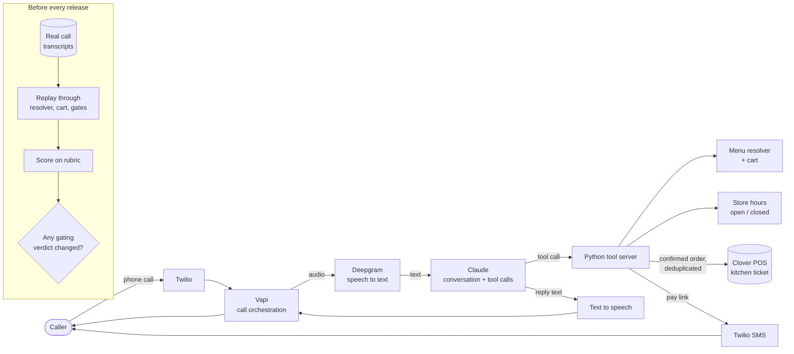

# Haniya - a production voice agent for a restaurant phone line

Haniya answers every phone call at Wok & Karahi, a halal Chinese, Indian and Pakistani restaurant in Houston. She takes the order, writes it into the restaurant's Clover point-of-sale system so it prints in the kitchen, and texts the caller a link to pay.

This repo is a small, runnable slice of that system for review. The production code lives in a private repo. Built by Abbas Zoeb with AI coding agents (Claude Code).

## In production

- 91 phone orders taken from Sep 1 into October 2026
- 278 real calls scored on one rubric
- Real calls replayed before every release
- About $0.13 a call
- 6,700+ automated tests and 100+ CI workflows across the restaurant's system
- About 800 guest orders a month across the restaurant's system

## What a call does

1. The caller dials the restaurant's number. Twilio carries the call to Vapi, which runs the live conversation.
2. Deepgram turns the caller's speech into text. Claude decides what to say and which tool to call.
3. Every tool is a Python endpoint on our own server: look up a dish, add it to the cart, check if the restaurant is open, place the order. Prices, options and hours come from the server and the POS, never from the model.
4. Before placing, Haniya reads the order back and waits for a spoken yes.
5. The order is written into Clover once. Submits are locked and deduplicated, so a retry or a dropped call cannot create a duplicate ticket.
6. Twilio texts the caller a pay link. Haniya tells them when it will be ready, where to pick it up and when the restaurant closes.



## How the evals work

Three pieces, all in `evals/`:

- **Rubric** (`evals/rubric.py`). The dimensions every call is scored on: filler around a tool call, more than one question in a turn, re-asking something the caller already said, honoring a language request, order placed, pay link sent, full wrap-up, dead-ended questions, caller sentiment and the single main failure. Each dimension can be "na" when it did not apply, so an info-only call does not count against order completion.
- **Scorer** (`evals/scorer.py`). Two graders with one output shape. The default is rule-based: deterministic, offline and free, so it can gate CI. The optional LLM judge sends the rubric to Claude as a forced tool, so the answer comes back as a structured object. It retries transient errors and returns an empty, excluded score on failure, so one bad call never breaks a batch.
- **Replay runner** (`evals/run.py`). Scores every transcript, prints a scorecard, and with `--check` diffs each call against the last baseline. Any call whose verdict moves on a gating dimension fails the check. In production this runs over real calls before a release; here it runs over a handful of made-up transcripts in `evals/transcripts/`.

The scorer is tested too: each transcript carries the labels a person gave it, and `--agreement` reports every place the scorer disagrees.

```
python3 -m evals.run                  # scorecard
python3 -m evals.run --agreement      # scorer vs human labels
python3 -m evals.run --check          # replay vs baseline, exit 1 on a gating change
python3 -m evals.run --baseline       # record a new baseline
ANTHROPIC_API_KEY=... python3 -m evals.run --judge llm   # grade with Claude instead (costs API credits)
```

## One slice of the agent

`haniya_slice/choice_question.py` builds the question Haniya asks when a dish has a required choice (which rice, which side). The model used to write that sentence itself from a list of option names, and could drop options, call a paid option included, or read a long list in one breath. Now the server builds the sentence from the option data: most-chosen options first, a cap on how many are read aloud, every extra cost stated in words, and exactly one question per turn. For a combo with several choices it offers the set most people pick as a single question, and only when real pick counts back the claim.

The option names and prices in the tests are made up.

## Run it

Python 3.10+. The harness and the slice use the standard library only; pytest runs the tests.

```
pip install -r requirements.txt
python3 -m pytest -q
python3 -m evals.run --agreement --check
```

## What is not here

The system prompt, the menu, real calls, guest data, keys and deployment config stay private. The transcripts in this repo are fictional and use fictional names and 555 numbers.

## License

All rights reserved. Shown for evaluation only. See `LICENSE`.
